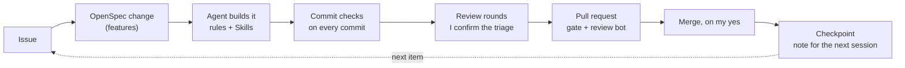
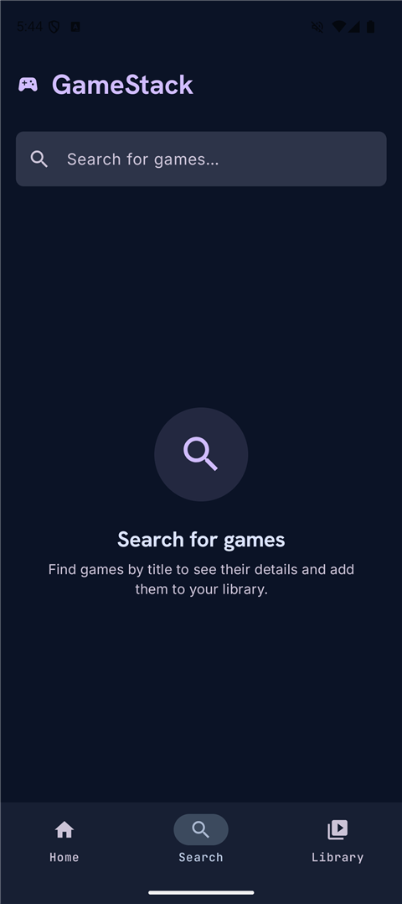
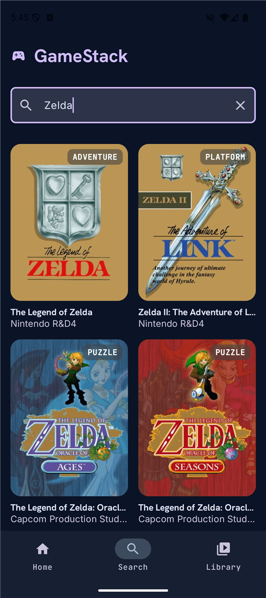
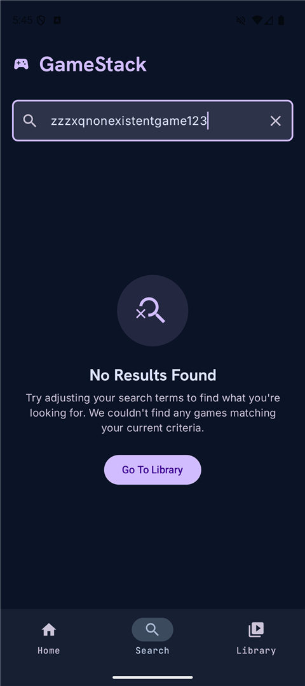
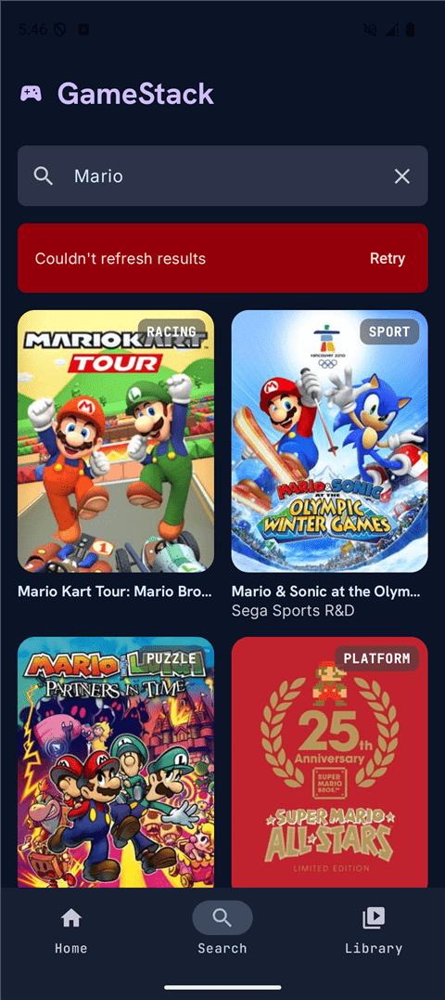
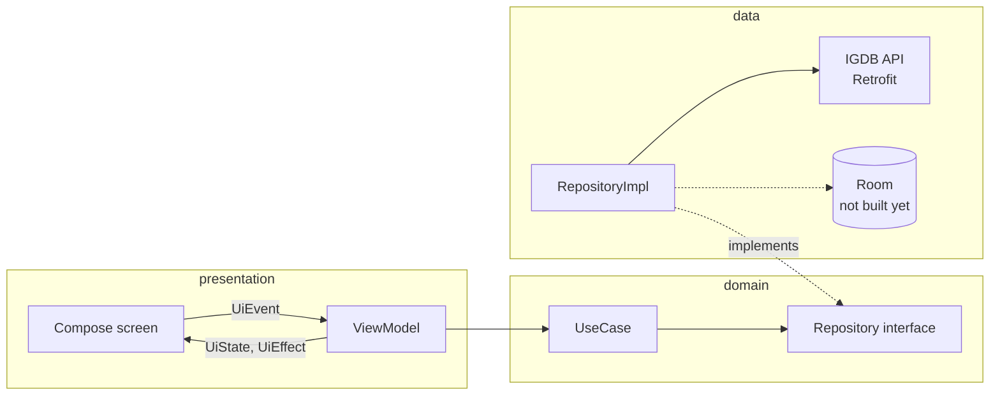

# GameStack

[](https://github.com/voltek/GameStack/actions/workflows/gate.yml)
[](LICENSE)
[](https://claude.com/claude-code)

Two things, built together:

- **🧰 A harness for building software with AI agents**: rules, Skills, decision
  records, review loops and a CI gate around Claude Code, proven on the app below
  and meant to be taken to other projects.
- **📱 An Android app** to explore video games and keep a personal library, on the
  [IGDB API](https://api-docs.igdb.com/), headed for the Play Store.

Both are a case study in building software well with AI assistance
([`PRODUCT.md`](docs/project/PRODUCT.md) § *Why this project exists*).

## 🧰 The harness

**How it works:** agents write the code and the documents, and I review every
change. The harness gives the agents their rules and procedures, and checks their
work, in the repository and on GitHub.

**🤖 In the repository: what the agent reads and runs**

| Piece | Where | What it does | Outside Android |
|---|---|---|---|
| **Rules** | [`CLAUDE.md`](CLAUDE.md), [`.claude/rules/`](.claude/rules/) | `CLAUDE.md` holds only what binds every turn, under a size a test checks; the rules for one area of the code load when a file there is touched. | The mechanism; the rules are this app's |
| **Hooks and permissions** | [`settings.json`](.claude/settings.json), [`.claude/hooks/`](.claude/hooks/) | What must hold every time is a mechanism, not prose: deny rules block skipped git hooks and changes to branch protection; hooks load each session's state and ask before a lesson goes into agent memory. | Yes |
| **Skills** | [`.claude/skills/`](.claude/skills/) | One procedure per repeatable task, loaded only when invoked: each layer's code and tests, device checks, shipping a branch. | Shipping and session Skills; layer Skills are Android |
| **Review loop** | [`review-round`](.claude/skills/review-round/SKILL.md) | Local `/code-review` rounds before the pull request, capped per branch, with every finding triaged in a table I confirm. | Yes |
| **Decisions** | [`decisions/`](docs/project/decisions/) | One ADR per decision in force, each naming what enforces it: a test, a CI check, a setting, or prose only. | Yes |
| **Specs** | [`openspec/`](openspec/) | Each feature starts from an OpenSpec change, a scenario per behaviour, verified before review. Adopted after Search; Detail is the first feature to run it. | Yes |
| **Session state** | [`checkpoint`](.claude/skills/checkpoint/SKILL.md) | Each session starts from a short note of where the work stands and what comes next, kept outside the repository. | Yes |
| **Commit checks** | [`.githooks/`](.githooks/) | Messages and branch names checked on every commit and push, by the same script CI runs, once a Gradle build has installed the hooks. | Yes |

**🐙 On GitHub: what no agent can skip**

| Piece | Where | What it does | Outside Android |
|---|---|---|---|
| **Branch protection** | [Settings](docs/project/TOOLING.md#2-branch-protection-on-main) | `main` takes no direct or forced push; a pull request merges only with the checks green and every review thread resolved, administrators included. | Yes |
| **CI gate** | [`gate.yml`](.github/workflows/gate.yml) | Build, test and lint on every pull request and push to `main`. | Any Gradle project |
| **Commit checks** | [`commits.yml`](.github/workflows/commits.yml) | Every commit, the pull request's title and body, and the branch name. | Yes |
| **Review bot** | [Codex](docs/project/TOOLING.md#9-codex-review-on-github), [`claude.yml`](.github/workflows/claude.yml) | One external review round on each pull request; Claude answers when a comment mentions it. A Claude review workflow is kept but disabled in the repository's settings, which a copy does not carry. | Yes |
| **Pull request template** | [`pull_request_template.md`](.github/pull_request_template.md) | What changed, why, the issues, the verification and the review, a form CI checks. | Yes |
| **Issues and Project** | [Issue forms](.github/ISSUE_TEMPLATE/), [Product board](https://github.com/users/voltek/projects/1) | Pending work is an issue with a bucket and a priority, chosen into a short cycle at a triage; product issues sit on a public board by horizon: Now, Next, Later. | Yes |

<details>
<summary>🔄 How a change moves through the harness</summary>



</details>

The process itself is in [`CLAUDE.md`](CLAUDE.md); every piece, what it replaced
and what was ruled out is in [`TOOLING.md`](docs/project/TOOLING.md).

### 🔎 See it in action

- **A pull request through the whole loop:** [#209](https://github.com/voltek/GameStack/pull/209),
  two local review rounds, then the bot's round, its one finding checked and
  answered in its thread.
- **Code and documents kept in step:** commit [`a00cf8c`](https://github.com/voltek/GameStack/commit/a00cf8c),
  where a Skill and the code disagreed and both were fixed, marked `Drift: both`.
- **A decision with its mechanism:** [ADR 0066](docs/project/decisions/0066-agent-memory-holds-only-what-is-personal.md),
  agent memory holds only what is personal, enforced by a hook and its tests.

**Key decisions, and what they cost**

| Decision | Why | Cost, accepted |
|---|---|---|
| `CLAUDE.md` stays small; area rules load by path | Every line of it is paid on every turn, and adherence falls as it grows | An agent sees an area's rules only once it touches a file there |
| What must always hold is a hook, a deny rule or a test | A line of prose is a guideline an agent can miss | A pattern matches one spelling of a command, so the rest stays prose |
| Review rounds are capped and I confirm every triage | Each round finds as many items, but fewer real defects (see *Measured results*) | Some defects surface only in a later round |
| Session state lives outside the repository | Every pull request's diff would carry one person's live state | A team needs a shared home for it (#159) |

### 🚚 Using the harness in another project

- **The order to set it up in:** [`TOOLING.md`](docs/project/TOOLING.md)
  § *Rebuilding this elsewhere*.
- **No ready-made template yet:** a copy generalised for export is made when a
  second project takes the harness, not before (#68).

## 📱 The app

A catalog and personal library, not a store or a gaming platform.

- ✅ **Search** games
- 🔜 **Read** a game's details
- ⏳ **Keep** personal lists and **rate** what you have played

The full scope is in [`PRODUCT.md`](docs/project/PRODUCT.md), and the roadmap on
the public [Product board](https://github.com/users/voltek/projects/1). Real captures from
the emulator, not mockups; the design references are in
[`design/`](docs/project/design/).

<!-- One block per finished feature, in the order above: its video first, when it
has one, then its screenshots from docs/project/screenshots/<feature>/, four to a
row. A feature not finished has no block. -->

### 🔍 Search

<table>
  <tr>
    <td align="center" width="25%">
      <br>
      <sub>Initial state</sub>
    </td>
    <td align="center" width="25%">
      <br>
      <sub>Results</sub>
    </td>
    <td align="center" width="25%">
      <br>
      <sub>No results</sub>
    </td>
    <td align="center" width="25%">
      <br>
      <sub>Refresh error</sub>
    </td>
  </tr>
</table>

## 🛠️ Tech stack

| Area | Choice |
|---|---|
| **Language and UI** | Kotlin, Jetpack Compose (no XML), Material 3 |
| **Architecture** | MVI over Clean Architecture: `presentation` → `domain` ← `data` |
| **Network** | Retrofit, Kotlinx.serialization |
| **Storage** | Room, for the library (not built yet) |
| **Dependency injection** | Hilt |
| **Images** | Coil |
| **Navigation** | Navigation Compose, type-safe routes |
| **Tests** | JUnit 4, MockK, Turbine, Robolectric for Compose screens |
| **Platform** | Android 8.0+ (min SDK 26), portrait only, dark theme only |

<details>
<summary>🏗️ Architecture diagram</summary>



A feature's own code lives in `feature/<name>/`, and what two or more features
share in `core/`.

</details>

## ▶️ Running the app

**You need:** Android Studio, a device or emulator on Android 8.0 or later, and a
free Twitch account for IGDB's credentials.

1. **Get the credentials.** Register an application in the
   [Twitch Developer Console](https://dev.twitch.tv/console/apps) and copy its
   Client ID and a new Client Secret. IGDB's
   [Getting Started](https://api-docs.igdb.com/#getting-started) walks through it.
2. **Add them to `local.properties`** at the repository root, which git ignores:
   ```properties
   IGDB_CLIENT_ID=your_client_id
   IGDB_CLIENT_SECRET=your_client_secret
   ```
   Without them the app still builds, but it cannot reach IGDB.
3. **Run** the `app` configuration from Android Studio.

**Build and test** with the same three commands the CI gate runs:

```sh
./gradlew build   # compile and assemble
./gradlew test    # JVM tests, Compose screens included
./gradlew lint    # Android lint; an error fails it
```

The gate ([`gate.yml`](.github/workflows/gate.yml)) needs no credentials, since
nothing in it calls IGDB, but it does need the network: Gradle resolves the
dependencies, and Robolectric downloads its Android SDK jar when the tests run.

## 📊 Measured results

Measured once on 2026-11-12 and never updated
([ADR 0079](docs/project/decisions/0079-the-readme-is-checked-at-each-triage.md)).

- **31% fewer tokens before any task:** 37,752 → 25,986 per new session, after
  rules moved out of `CLAUDE.md` (35.8 KB → 3.1 KB) to load only when needed.
- **Review rounds:** every round finds about 9 items, but real
  defects drop from 3.3 in round 1 to 2.6 in round 2 and 2.2 in round 3
  ([ADR 0049](docs/project/decisions/0049-review-rounds-are-capped-and-the-human-confirms-the-triage.md)).
  The cost: of the 151 defects in the branches' own diffs, 20 surfaced only in
  round 3 or later.

<details>
<summary>📐 How it was measured</summary>

**Tokens.** Claude Code 2.1.323 and Claude Opus 5.5, on commit `898312b` (`main`,
2026-10-31) and commit `545db06` (`main`, 2026-11-12): `claude -p --output-format
json "Reply with the single word: ok"` from the repository root, adding the input,
cache-creation and cache-read tokens. Two runs per commit gave the same total, and
what loads from outside the repository, such as agent memory, was the same for
both. The Skills' descriptions, which also load at start, grew in the same span,
so the drop is `CLAUDE.md`'s net of that.

**Review rounds.** 74 triaged `/code-review` rounds over 28 branches, 2026-10-22 to
2026-11-06. An original defect is one in the branch's own diff, not in an earlier
round's fix. ADR 0049 weighed the same cost, 17 of 113, over the rounds up to
2026-11-03.

| Round | Rounds run | Findings per round | Real defects per round | Of them, in the branch's own diff |
|---|---|---|---|---|
| 1 | 28 | 9.0 | 3.3 | 88 |
| 2 | 25 | 9.1 | 2.6 | 43 |
| 3 | 16 | 8.9 | 2.2 | 17 |
| 4 | 4 | 8.5 | 1.0 | 3 |
| 5 | 1 | 9.0 | 0.0 | 0 |

Rounds 4 and 5 rest on four rounds and one.

</details>

## 👤 Author

Built by **Alan Hernández** with Claude Code. A personal project; pull requests
from others are not expected.

- **GitHub:** [@voltek](https://github.com/voltek)
- **LinkedIn:** [alan-hernandez-voltek](https://www.linkedin.com/in/alan-hernandez-voltek/)
<!-- Uncomment once the portfolio site is live; check whether it answers on the bare domain or on www.
- **Portfolio:** [alanhernandez.dev](https://alanhernandez.dev/)
-->

## 📄 License

- **Code and documents:** [MIT](LICENSE)
  ([ADR 0078](docs/project/decisions/0078-the-repository-is-mit-licensed.md)).
- **Not covered:** the game images in the screenshots, which belong to their
  owners, and the game data and images the app shows, which come from
  [IGDB.com](https://www.igdb.com/) under
  [Twitch's Developer Services Agreement](https://legal.twitch.com/en/legal/developer-agreement/)
  and belong to Twitch or its licensors.
